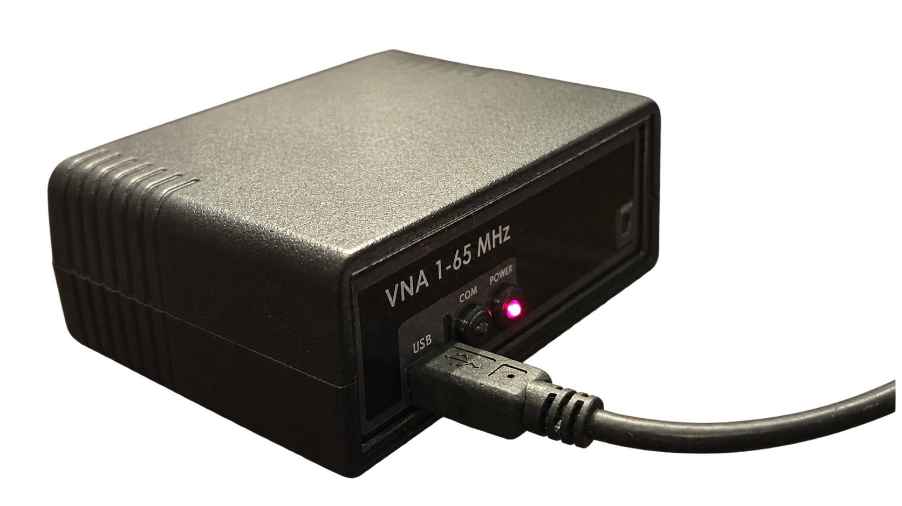
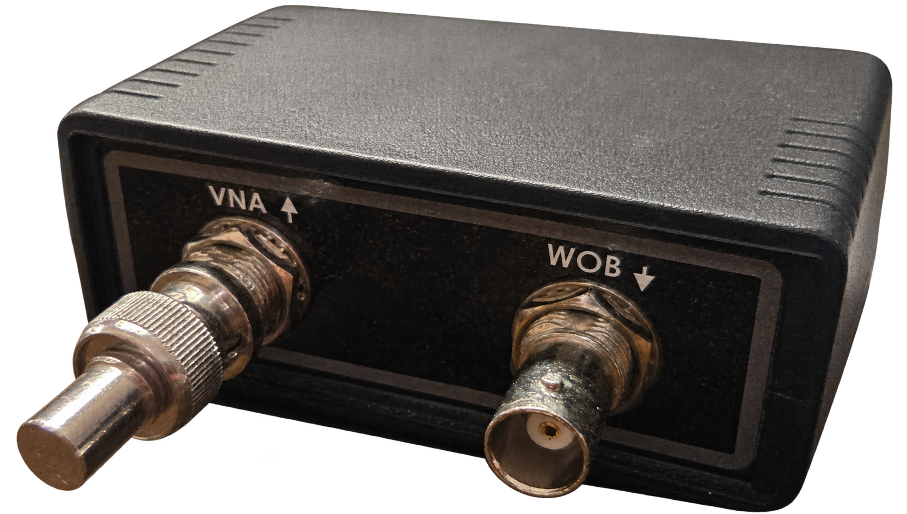
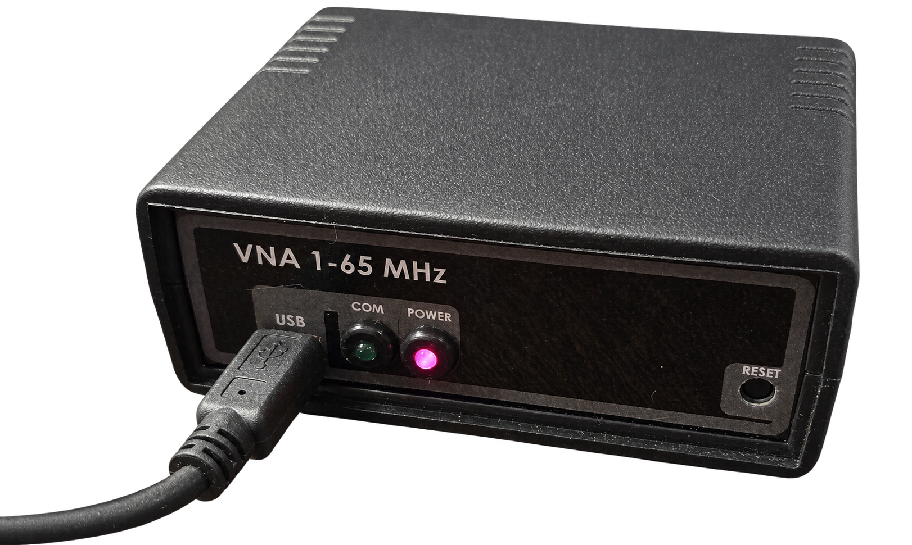
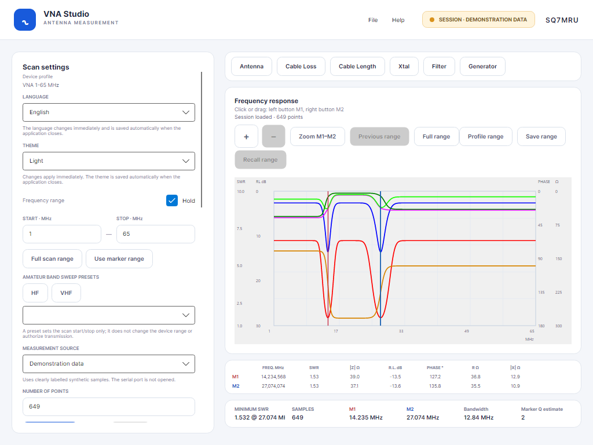
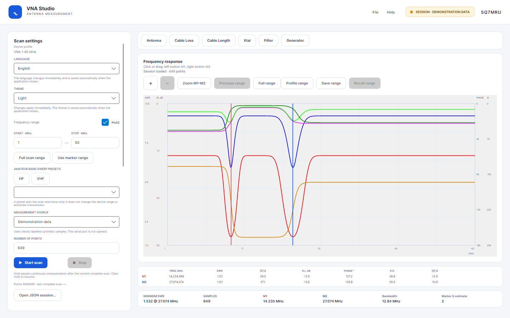
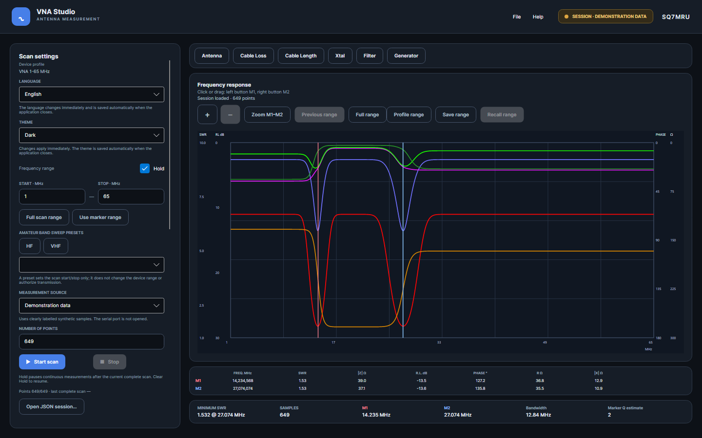
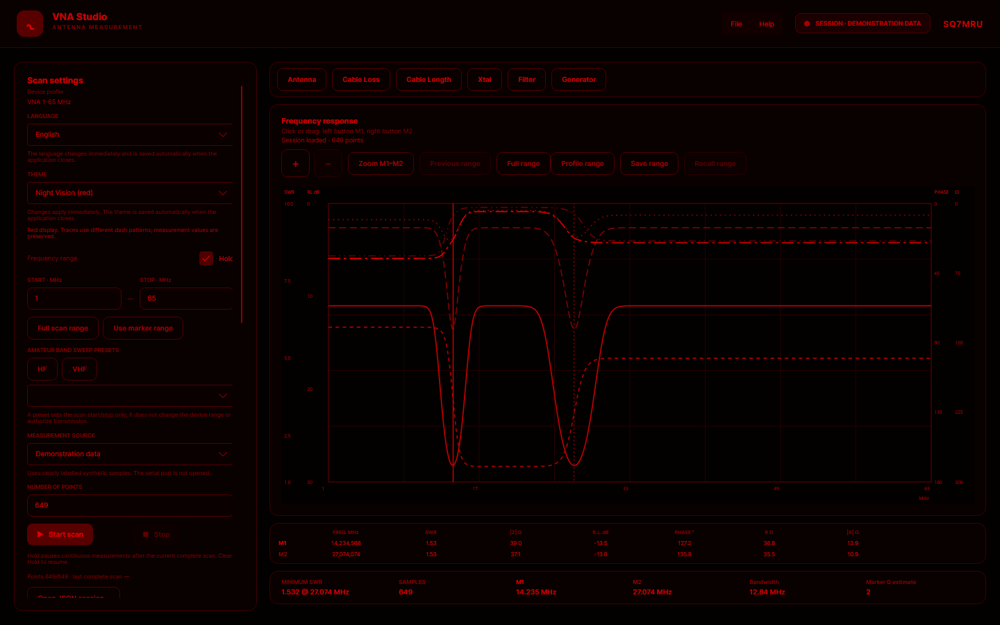
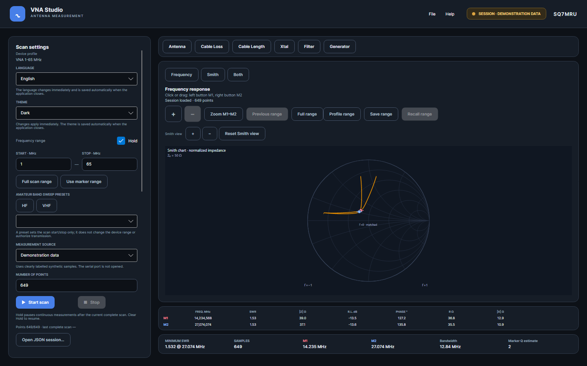
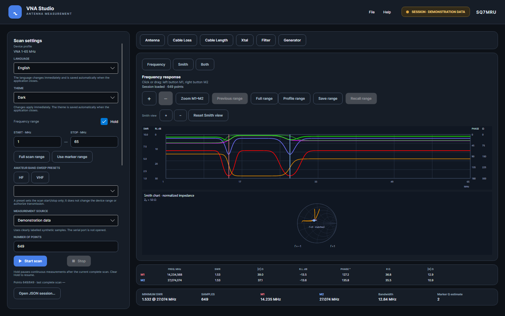

# VNA Studio

**English** | [Polski](README.pl.md)

VNA Studio is a C# and Avalonia application under development for the **VNA 1–65 MHz**, with the **SQ7MRU** callsign on the right of the header. The device profile is named after the hardware; the app uses a custom plot control.

### Tested hardware

These are three separate background-removed, tightly cropped edits of the supplied photos:

<p align="center">
  
  
  
</p>

Hardware checks were performed on the pictured VNA 1–65 MHz over COM9, including a sweep with a 50 Ω termination. The termination check confirms basic acquisition and conversion behavior; it does not by itself verify absolute RF accuracy, full calibration, or phase sign.

The window can be minimized, maximized and resized. Its minimum size is 1024 × 768 DIP; the settings panel scrolls and the plot adapts to the available space. Interface fonts are sized to keep the main controls readable at this minimum.

## Language and themes

The first launch defaults to **English** and **Dark**. Choose **English** or **Polski** in the settings panel to change interface text and number formatting immediately. Language, theme, port and the other supported preferences are saved automatically when the application closes normally; **Save settings** also saves them immediately. Saved choices take precedence over defaults; older files missing language or theme use English/Dark for those missing fields. The `Language` value in `settings.json` is `en-US` or `pl-PL`.

The preferences file is read at startup. External edits take effect after restarting; saving the file does not reload older values over newer edits in the interface.

Translations are in [Strings.resx](src/Vna.Localization/Resources/Strings.resx) and [Strings.pl.resx](src/Vna.Localization/Resources/Strings.pl.resx); tests check matching keys and format arguments.

Choose **Light**, **Dark** or **Night Vision (red)**. Theme changes apply to the interface and plot without changing measurements, markers or zoom. Night Vision uses red shades and different line patterns.

These Avalonia/Skia previews show the 1440 × 900 client area and 649 synthetic demonstration samples, not hardware measurements.

The compact layout at the minimum 1024 × 768 DIP window size is also available: 

### Light



### Dark



### Night Vision



[Theme configuration and preview generation](docs/THEMES.md).

## Run

Install the .NET 10 SDK and run from the repository root:

```powershell
dotnet run --project src/Vna.App/Vna.App.csproj
```

The initial restore may download NuGet packages. Choose **Demonstration data**, **VNA hardware**, or **Session playback** as the measurement source. Hardware scans use the configured serial path; connection or scan errors stay visible and never trigger a demo fallback. Playback requires a loaded session and only replays its exact saved sweep range and point count, without interpolation. Serial acquisition and Stop/reconnect have been exercised on the user's VNA at COM9; Basic RF conversion has also been checked with a 50-ohm termination and compared with the original algebra; absolute measurement accuracy and full calibration remain unverified. See the [measurement report](docs/measurements/2026-11-04-com9-50ohm.md).

The built-in **VNA 1–65 MHz** profile is loaded through `IOptions<LegacyAnalyzIniOptions>`. Its snapshot, calibration coefficients and plot colors are stored in JSON sessions. The legacy INI file is an implementation input, not the device's displayed profile name. `GRAF_PROP` colors are interpreted as Windows COLORREF values. Calibration coefficients are not applied to raw ADC data until their meaning has been verified.

The interface identifies the profile as **VNA 1-65 MHz**, matching the device enclosure shown in the owner's photographs.

The selected source and port name are saved in `settings.json` in the system's application data directory (`LocalApplicationData`). **Detect system ports** lists names reported by the operating system. The path is passed unchanged and can be `COM5`, `/dev/ttyUSB0`, `/dev/ttyACM0`, or another system-specific value. It is empty by default; the example port from the INI is not imposed.

`Vna.Devices.Transport` provides a serial transport with exact-length reads, timeouts and cancellation. The miniVNA/Analyser 306b driver uses 115200 8N1 and selects four- or six-byte sample frames from the separate `SVNA` flag, independently of `VNA_type`. The user's 65 MHz device returns four bytes per point; a 649-point scan receives 2596 bytes. Additional SVNA bytes remain uninterpreted. See the [protocol evidence and limits](docs/DEVICE-PROTOCOL.md), including the remaining RF conversion limitations.

The [detailed communication guide](docs/VNA-COMMUNICATION.md) explains the exact command bytes, DDS calculations, response layout, ADC conversion, timeout and Stop behavior. A [Polish version](docs/VNA-COMMUNICATION.pl.md) is also available.

Plot **+ / −** buttons halve/double the visible frequency span around its center, clamped to the device profile and a minimum span of 1 Hz. The same keys work while the plot has focus. **Previous range** restores earlier zoom steps; **Full range** returns to the captured data range. Zoom changes only the view and is retained when repeating the same scan settings, including continuous scanning. Changing scan settings resets the view. Zooming does not acquire additional samples or increase measurement resolution.

## Plot and sessions

Press **Start scan** for one sweep. Clear **Hold** to start continuous acquisition; checking **Hold** pauses after the current complete sweep. **Stop** cancels an in-progress sweep, enables Hold and keeps the last complete result. Saved sessions preserve the device's actual frequency grid, including a DDS final sample below the requested Stop limit.

The custom plot has grids, axis labels and six traces, with screenshot-derived SWR ticks and phase/ohm scales on the right. **RL ×2** switches the return-loss display range from 0–30 dB to 0–60 dB without altering measurement values; the setting is saved with other display preferences. **RL offset** adds a dB correction to displayed return loss and recalculates displayed SWR/impedance without rewriting session samples; it is saved in `settings.json`. **Full marker values** shows every marker column; when off, the table keeps frequency and return loss. Choose each trace color from the settings panel and reset it to the profile default; **All/None** controls visibility. Night Vision keeps a red palette while retaining the chosen colors for Light and Dark. Left- and right-click or drag select M1 and M2 on the nearest sample; keyboard arrows move the focused marker by one sample. Controls zoom to the markers, navigate zoom history and restore the full scan. Missing or invalid values break traces. A marker table shows both marker values; the summary includes absolute marker bandwidth and the screenshot-derived marker Q estimate (clearly distinguished from physical resonance Q). A 50 Ω impedance reference can be toggled independently; an optional marker column converts signed reactance to capacitance or inductance. The plot offers a profile range and separate in-memory range save/recall. The File menu provides session open/save, import of the identified Analyser antenna CSV columns, and unit-labelled VNA Studio CSV export; About identifies VNA Studio · SQ7MRU and its version. Version 4 JSON sessions preserve scalar Filter samples; versions 1–3 migrate. CSV includes separate `Transmission_dB` and `AnalysisMode` columns and continues to import the previous eight-column Studio header. Color and reference-line preferences are application settings. Axis scales and geometry still need comparison against the original using the same samples.

The Antenna chart can show **Frequency**, **Smith**, or **Both**. Smith uses the same acquired samples, M1/M2 markers and frequency window; geometric zoom and pan are separate from frequency zoom. The selected chart view is saved in `settings.json`. When phase sign is unverified, the chart shows mirrored possibilities instead of assigning an unsupported inductive/capacitive sign.



Frequency and Smith charts can also be shown together: 

HF amateur band presets set scan limits within the selected device profile; the supplied 65 MHz profile excludes the 2 m preset. See [band preset sources and scope](docs/BAND-PRESETS.md).

Cable Length mode estimates a cable from the spacing of two adjacent, same-type resonance markers and the editable velocity factor. Cable Loss shows a one-port estimate only after confirming an open/short cable end at ANT; a 50 Ω terminator is not the right fixture. Filter mode uses separate scalar response samples in demo or session playback; hardware Filter scans are disabled until the command is verified for this VNA 1–65 MHz, and the values are not calibrated S21. See [Cable Loss](docs/CABLE-LOSS.md) and [Filter](docs/FILTER-MODE.md). This Cable Length equation is derived from the reflected round trip; read the [measurement assumptions](docs/CABLE-LENGTH.md). Generator mode loads ten frequency memories from `analyz.ini` and validates manual frequency entry against the profile. Its hardware control is disabled; VNA Studio sends no generator command and the physical output state is unknown. See [Generator](docs/GENERATOR.md).

Xtal mode also includes a manual resonance-Q calculator using the ±45° phase-edge method and formula from the supplied measurement manual. It requires manually entered resonance and bandwidth-edge frequencies; it does not automatically fit crystal parameters. See [RESONANCE-Q.md](docs/RESONANCE-Q.md) and [GENERATOR.md](docs/GENERATOR.md).

`RfSampleCalculator` converts signed return loss and phase to SWR and impedance so that the six demonstration traces are mathematically consistent. The original phase convention and calibration still need verification.

See the [OpenSpec status](openspec/changes/port-vna-to-csharp/README.md) and [roadmap based on the original screenshots](openspec/changes/port-vna-to-csharp/roadmap-screenshots.md). The supplied installers, reference manuals, screenshots, and decompilation outputs are kept outside this project directory and are not needed to build VNA Studio.

## Tests and releases

Run `dotnet test Vna.slnx`. The xUnit suite covers geometry, sessions, CSV export, localization, themes, and Avalonia Headless/Skia interactions, including resizing and DPI changes. The [session format and offline playback procedure](docs/SESSION-FORMAT.md) include a loadable [example session](docs/examples/demo.vnasession.json). The OpenSpec reviews describe the checks and remaining limitations.

Publishing a GitHub Release with a `vX.Y.Z` tag triggers 11 builds: Windows x86/x64/ARM64, Linux x64/ARM/ARM64 (glibc and musl), and macOS x64/ARM64. After tests and all matrix builds succeed, the release receives self-contained archives and `SHA256SUMS.txt`. Cross-published targets still require runtime verification on their operating system. See [release instructions](docs/RELEASING.md).


