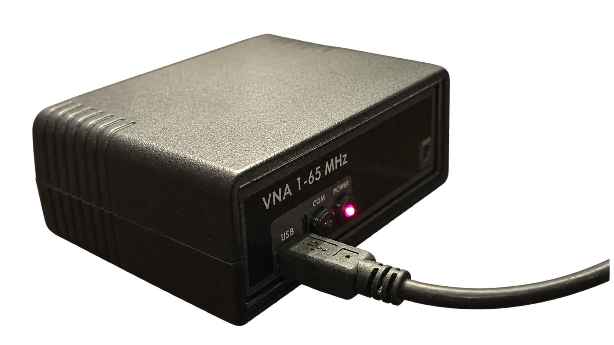
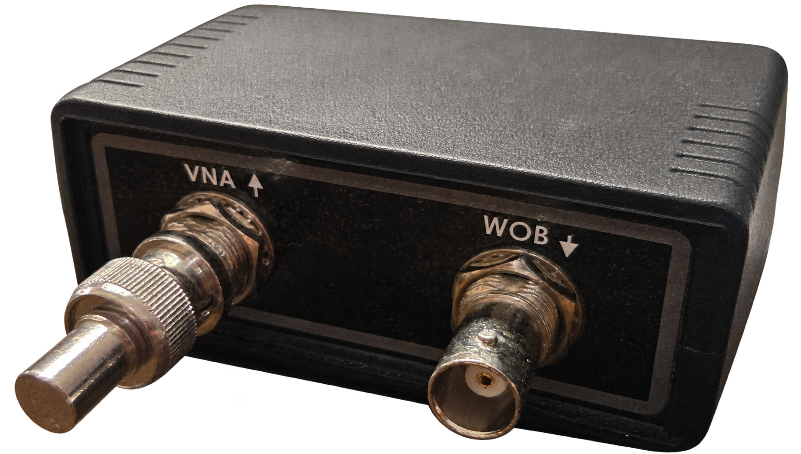
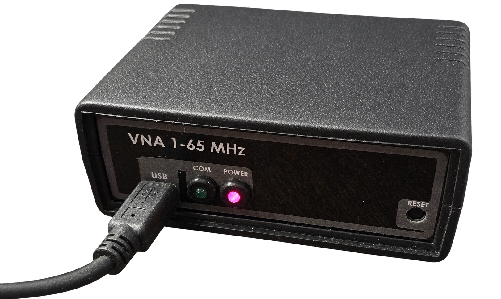
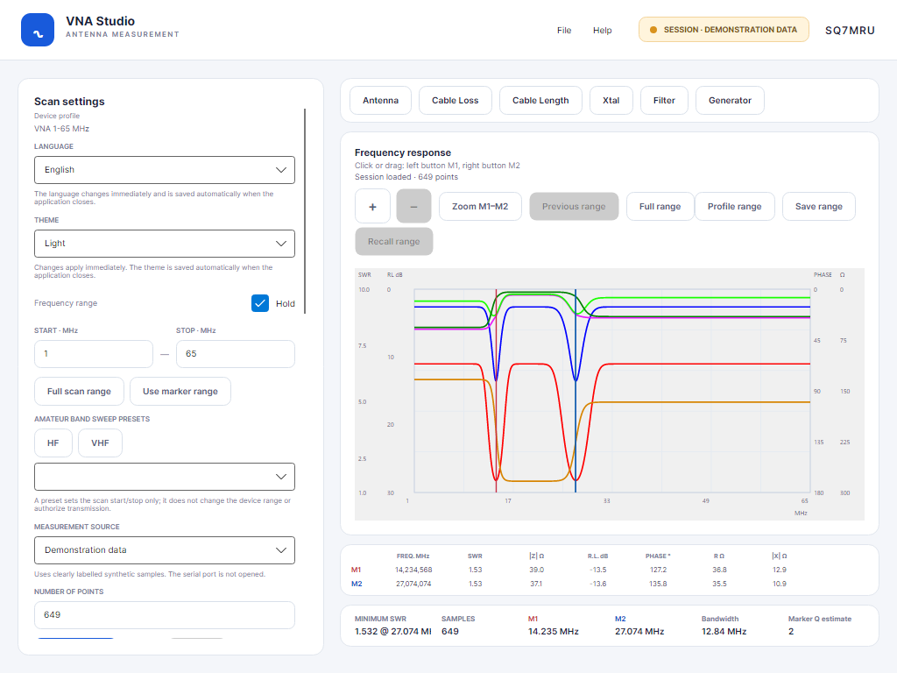
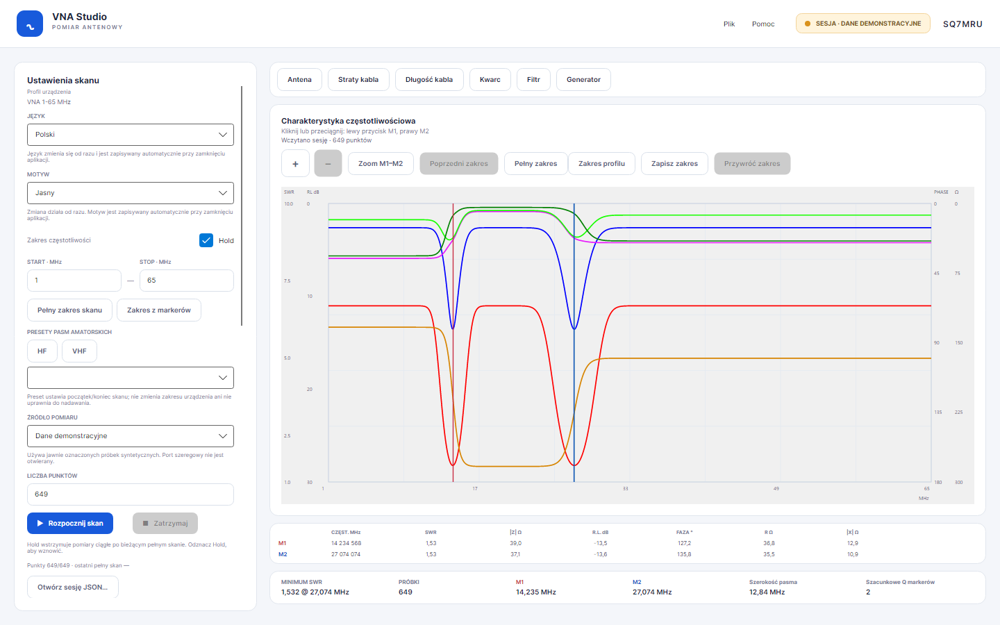
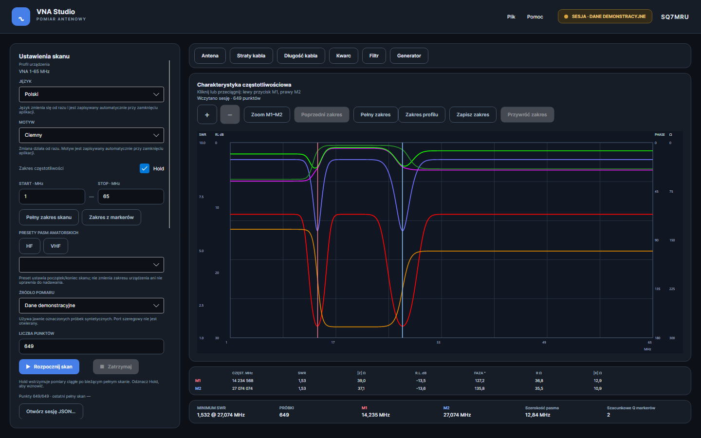
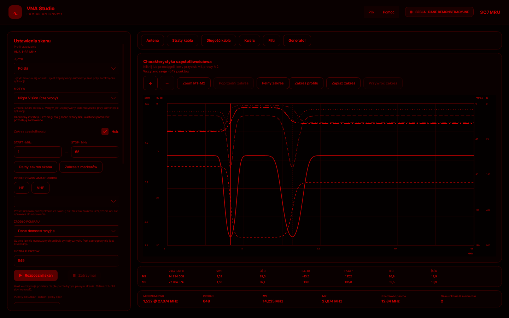
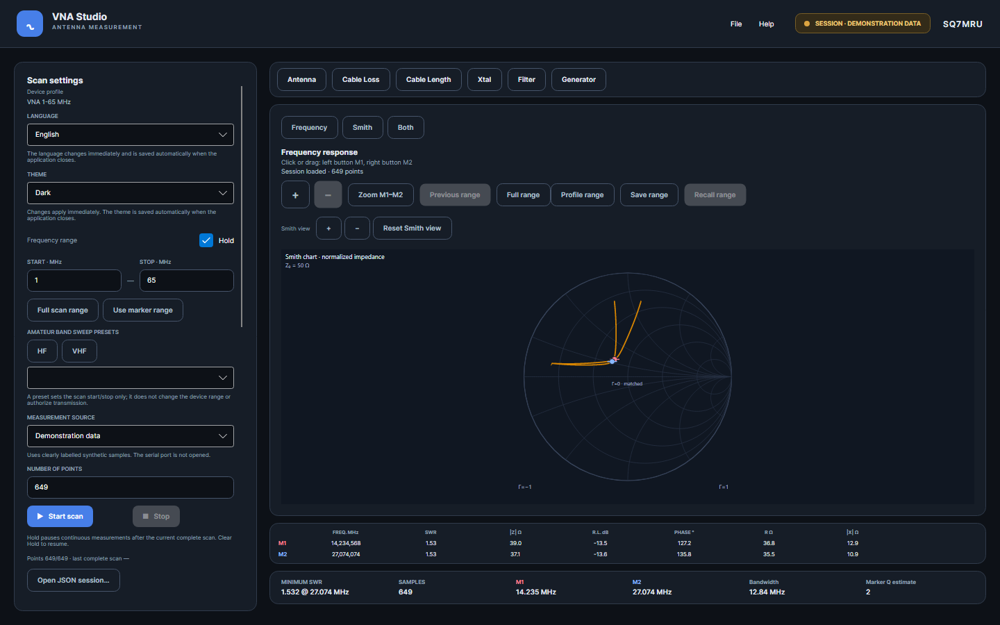
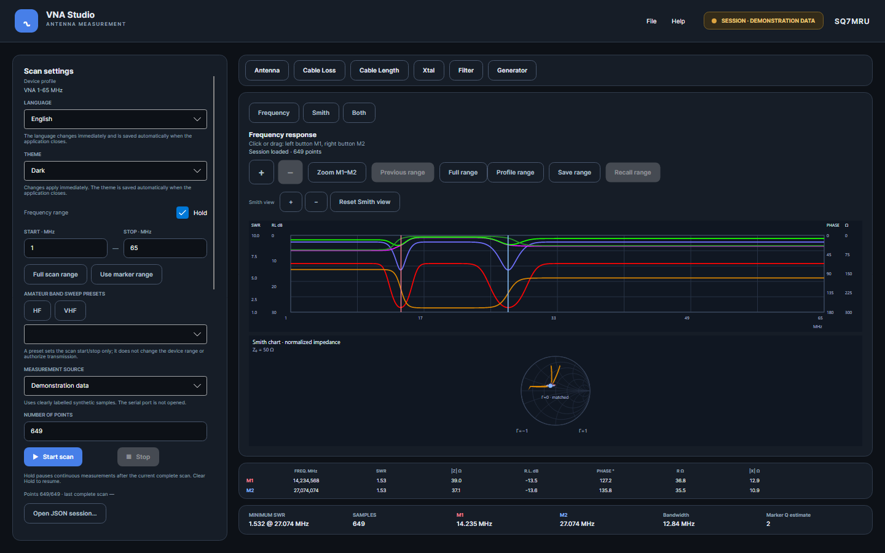

# VNA Studio

[English](README.md) | **Polski**

VNA Studio to aplikacja rozwijana dla urządzenia **VNA 1–65 MHz** w C# i Avalonia, ze znakiem **SQ7MRU** po prawej stronie nagłówka. Nazwa profilu odpowiada modelowi sprzętu; aplikacja korzysta z własnej kontrolki wykresu.

### Sprawdzone urządzenie

Poniżej są trzy osobne zdjęcia użytkownika z usuniętym tłem i kadrem skupionym na urządzeniu:

<p align="center">
  
  
  
</p>

Testy sprzętowe wykonano na przedstawionym VNA 1–65 MHz przez COM9, w tym skan z terminatorem 50 Ω. Sprawdzenie terminatorem potwierdza podstawowy odczyt i działanie przeliczeń; samo w sobie nie potwierdza bezwzględnej dokładności RF, pełnej kalibracji ani znaku fazy.

Okno można minimalizować, maksymalizować i zmieniać jego rozmiar. Minimalny rozmiar wynosi 1024×768 DIP; panel ustawień przewija się, a wykres rozciąga się razem z oknem. Czcionki interfejsu są dobrane tak, by główne kontrolki mieściły się przy tym rozmiarze.

Pierwsze uruchomienie domyślnie wybiera **English** i **Dark**. W panelu ustawień wybierz **Polski** lub **English** — napisy i format liczb zmieniają się od razu. Język, motyw, port i pozostałe obsługiwane preferencje są zapisywane automatycznie przy zwykłym zamknięciu aplikacji; **Zapisz ustawienia** zapisuje je również od razu. Zapisany wybór ma pierwszeństwo przed wartościami domyślnymi; brakujące pola języka/motywu w starszym pliku otrzymują English/Dark. W `settings.json` pole `Language` przyjmuje `pl-PL` lub `en-US`.

Plik preferencji jest odczytywany przy starcie. Ręczne zmiany pliku działają po ponownym uruchomieniu; własny zapis nie przeładowuje starszych wartości na nowsze zmiany w interfejsie.

Teksty znajdują się w [Strings.resx](src/Vna.Localization/Resources/Strings.resx) (angielski) i [Strings.pl.resx](src/Vna.Localization/Resources/Strings.pl.resx) (polski). W obu plikach należy dodawać te same klucze; testy sprawdzają ich kompletność i argumenty formatowania.

## Motywy i podglądy

W polu **Motyw** wybierz **Jasny**, **Ciemny** lub **Night Vision (czerwony)**. Zmiana obejmuje interfejs i wykres od razu; **Zapisz ustawienia** zachowuje motyw, język, port i wybrane kolory przebiegów. Kolor każdej krzywej można wybrać lub przywrócić z profilu; **Wszystkie/Żadne** steruje ich widocznością. Night Vision wymusza czerwone odcienie i różne wzory linii, zachowując wybór kolorów dla pozostałych motywów. Dane pomiarowe, markery i zoom pozostają zachowane.

Podglądy przedstawiają obszar klienta okna 1440×900, z 649 syntetycznymi próbkami demonstratora. Zostały wyrenderowane przez Avalonia/Skia; nie przedstawiają pomiarów urządzenia.

Podgląd kompaktowego układu przy minimalnym rozmiarze 1024×768 DIP: 

### Jasny



### Ciemny



### Night Vision



[Konfiguracja motywów i odświeżanie podglądów](docs/THEMES.md).

## Uruchomienie

Wymagany jest .NET SDK 10. Z katalogu repozytorium:

```powershell
dotnet run --project src/Vna.App/Vna.App.csproj
```

Pierwsze uruchomienie może wymagać pobrania pakietów NuGet. Wybierz źródło **Dane demonstracyjne**, **Urządzenie VNA** lub **Odtwarzanie sesji**. Pomiary sprzętowe korzystają ze skonfigurowanej ścieżki portu; błąd połączenia lub skanu pozostaje widoczny i nigdy nie uruchamia danych demo. Odtwarzanie wymaga wczytanej sesji albo ukończonego skanu w pamięci i używa dokładnego zakresu oraz liczby punktów, bez interpolacji. Na urządzeniu użytkownika pod COM9 sprawdzono skan 649 punktów, Stop podczas odczytu i ponowne uruchomienie skanu. Podstawowe przeliczenia RF sprawdzono z terminatorem 50 ohm i algebrą oryginału; dokładność pomiarowa i pełna kalibracja wymagają dalszej weryfikacji ([raport](docs/measurements/2026-11-04-com9-50ohm.md)); ramka ma 4 bajty na punkt, a opcją wybierającą 6 bajtów jest osobne `SVNA`, nie `VNA_type`.

Wbudowany profil **VNA 1–65 MHz** jest odczytywany z opcji legacy INI i przekazywany do typowanych ustawień protokołu pluginu VNA65. Plugin zawiera komendy, konfigurację DDS i przeliczenie ADC na wielkości RF; ogólny bajtowy transport szeregowy jest w `Vna.Devices.Transport`. Plugin udostępnia hostowi neutralny descriptor profilu. Migawka przejściowego `DeviceProfile` pozostaje w JSON sesji dla zgodności ze starszymi zapisami. Kolory `GRAF_PROP` zachowują dawny format Windows COLORREF. Konwerter stosuje współczynniki zgodnie z kodem, ale ich wartości nie zostały niezależnie zweryfikowane jako kalibracja fizyczna.

Zobacz [kontrakt pluginów urządzeń](docs/DEVICE-PLUGINS.pl.md): zgodność wersji API, jawna rejestracja, descriptory profilu i poziomy dowodów możliwości. Dostępny jest też [opis angielski](docs/DEVICE-PLUGINS.md).

Profil jest wyświetlany jako **VNA 1-65 MHz**, zgodnie z oznaczeniem na obudowie widocznym na zdjęciach użytkownika. Implementacje urządzeń są osobnymi, jawnie rejestrowanymi pluginami; obecna aplikacja zawiera plugin VNA 1–65 MHz i rozwiązuje aktywną parę plugin/profil z osobnej sekcji ustawień.

Wybierz **Pomoc → Zarejestrowane profile urządzeń**, aby zobaczyć modele i profile dostarczone przez zarejestrowane pluginy, ich stabilne identyfikatory, zakresy częstotliwości, impedancję odniesienia oraz deklarowane możliwości i poziom dowodów. Aktywny wybór jest przechowywany osobno od preferencji wyglądu, w sekcji `DeviceSelection` pliku `settings.json`; zobacz [wybór urządzenia](docs/DEVICE-SELECTION.pl.md). Zmiana zaczyna działać po ponownym uruchomieniu programu. Nieznany lub niejednoznaczny wybór zatrzymuje start zamiast po cichu przełączać się na Demo.

Wybrane źródło i nazwa portu są zapisywane w `settings.json` w systemowym katalogu danych użytkownika aplikacji (`LocalApplicationData`). Przycisk „Wykryj porty systemowe” pobiera nazwy zgłaszane przez system. Ścieżka jest przekazywana sterownikowi bez zmian: może mieć postać `COM5`, `/dev/ttyUSB0`, `/dev/ttyACM0` albo inną ścieżkę systemową. Domyślnie pole jest puste; aplikacja nie wyprowadza ścieżki portu z profilu urządzenia.

Warstwa `Vna.Devices.Transport` zawiera transport szeregowy z odczytem dokładnej liczby bajtów, timeoutem i anulowaniem. Plugin VNA 1–65 MHz używa 115200 8N1 oraz wybiera ramkę 4- lub 6-bajtową na podstawie osobnej flagi `SVNA`, niezależnie od `VNA_type`. Urządzenie użytkownika zwraca 4 bajty na punkt: 649 punktów daje 2596 bajtów. Dodatkowe bajty SVNA pozostają nieinterpretowane. Zobacz [dowody i ograniczenia protokołu](docs/DEVICE-PROTOCOL.md).

[Szczegółowy opis komunikacji](docs/VNA-COMMUNICATION.pl.md) zawiera dokładne bajty komend, obliczenia DDS, układ odpowiedzi, przeliczenia ADC oraz działanie timeoutu i Stop. Dostępna jest również [wersja angielska](docs/VNA-COMMUNICATION.md).

Przyciski wykresu **+ / −** zmniejszają/podwajają widoczny zakres częstotliwości wokół jego środka, z ograniczeniem do zakresu profilu i minimum 1 Hz. Te same klawisze działają przy fokusie na wykresie. **Poprzedni zakres** cofa kroki zoomu, a **Pełny zakres** wraca do zakresu odebranych danych. Zoom zmienia tylko widok i jest zachowywany przy ponawianiu tych samych ustawień skanu, również podczas pomiarów ciągłych. Zmiana ustawień skanu resetuje widok. Przybliżenie nie pobiera dodatkowych próbek ani nie zwiększa rozdzielczości pomiaru.

**Start skanu** wykonuje jeden pomiar. Odznaczenie **Hold** rozpoczyna pomiary ciągłe; ponowne zaznaczenie wstrzymuje je po bieżącym pełnym skanie. **Zatrzymaj** anuluje skan, włącza Hold i zachowuje ostatni kompletny wynik. Zapis sesji zachowuje rzeczywistą siatkę częstotliwości urządzenia, również gdy ostatnia próbka DDS wypada poniżej granicy Stop.

Wykres ma własne siatki, etykiety osi i sześć przebiegów w kolorach z dostarczonego INI. Podziałka SWR pochodzi ze zrzutów; po prawej są skale fazy i Ω. **Pełne wartości markerów** pokazują wszystkie kolumny; po wyłączeniu tabela zawiera częstotliwość i return loss. **RL ×2** przełącza zakres prezentacji return loss z 0–30 dB na 0–60 dB. **Przesunięcie RL** dodaje korektę dB do wyświetlanego return loss i przelicza widoczne SWR/impedancję; nie zmienia próbek w sesji. Oba ustawienia są zapisywane w `settings.json`. Kliknięcie i przeciąganie lewym/prawym przyciskiem myszy ustawia M1/M2 na najbliższej próbce w widocznym zakresie. Przyciski pozwalają przybliżyć zakres markerów, wracać przez historię zoomu i wyświetlić pełny skan. Krzywe przerywają się przy brakujących lub nieprawidłowych wartościach. Panel skanu pokazuje postęp i czas ostatniego pełnego skanu. Tabela pokazuje wartości obu markerów, a podsumowanie szerokość `|f2−f1|` oraz szacunkowe Q odtworzone ze zrzutów (wyraźnie odróżnione od fizycznego Q rezonatora). Można niezależnie włączyć linię odniesienia 50 Ω oraz kolumnę przeliczającą signed X markerów na pojemność/indukcyjność, widok pełnego zakresu profilu oraz tymczasowy zapis/przywrócenie zakresu wykresu. Menu Plik udostępnia otwieranie/zapis sesji, import rozpoznanych kolumn CSV Analyser 306b oraz eksport jednostkowego CSV VNA Studio, a Pomoc → O programie pokazuje VNA Studio · SQ7MRU oraz wersję. Sesja JSON v4 zapisuje też próbki skalarnej transmisji; formaty v1–v3 są migrowane. CSV zawiera osobne kolumny `Transmission_dB` i `AnalysisMode`, a starszy 8-kolumnowy format Studio nadal można importować. Eksport CSV ma jawne jednostki i liczby zgodne ze standardem invariant. Zakresy osi i geometria są wstępne i wymagają porównania z oryginalnym programem na tych samych próbkach.

`RfSampleCalculator` przelicza podpisany return loss i fazę na SWR oraz impedancję. Korzysta z niego demonstrator, aby sześć przebiegów było ze sobą matematycznie spójnych. Konwencja fazy i kalibracja dla oryginalnego programu nadal wymagają potwierdzenia.

Tryb Długość kabla szacuje długość na podstawie odstępu dwóch sąsiednich markerów tego samego typu rezonansu i edytowalnego współczynnika skrócenia. Wzór wynika z drogi sygnału odbitego w obie strony; zobacz [założenia pomiaru](docs/CABLE-LENGTH.pl.md). Tryb Straty kabla pokazuje oszacowanie jednowrotnych strat dopiero po potwierdzeniu kabla open/short na ANT; terminator 50 Ω nie jest właściwym fixture. Tryb Filter używa osobnych próbek odpowiedzi skalarnej w demo lub odtwarzaniu sesji; skan sprzętowy jest wyłączony do potwierdzenia komendy dla VNA 1–65 MHz, a wynik nie jest skalibrowanym S21. Zobacz [Straty kabla](docs/CABLE-LOSS.pl.md) i [Filter](docs/FILTER-MODE.pl.md).

Tryb Xtal zawiera też ręczny kalkulator Q rezonansu z granicami fazy ±45° i wzorem z dostarczonej instrukcji. Wymaga ręcznego wpisania częstotliwości rezonansu i granic pasma; nie oblicza automatycznie parametrów zastępczych kwarcu. Generator wczytuje dziesięć pamięci z `analyz.ini` i sprawdza częstotliwość względem profilu. Sterowanie sprzętowe jest wyłączone; VNA Studio nie wysyła komend generatora, a fizyczny stan wyjścia jest nieznany. Zobacz polski opis [RESONANCE-Q.pl.md](docs/RESONANCE-Q.pl.md), angielski [RESONANCE-Q.md](docs/RESONANCE-Q.md) i [Generator](docs/GENERATOR.pl.md).

Widok Antena ma wariant **Frequency**, **Smith** lub **Both**. Wykres Smitha korzysta z tych samych próbek, markerów M1/M2 i zakresu częstotliwości; jego zoom geometryczny i przesuwanie są niezależne od zoomu częstotliwości. Wybrany widok jest zapisywany w `settings.json`. Gdy znak fazy nie jest potwierdzony, wykres pokazuje oba lustrzane rozwiązania i nie przypisuje bezpodstawnie znaku indukcyjnego/pojemnościowego.

Opis obsługi markerów, zoomu, przesuwania i wykresu Smitha znajduje się w [instrukcji wykresów](docs/PLOT-GUIDE.pl.md); [notatki z porównania](docs/PLOT-COMPARISON.pl.md) opisują podobieństwa i różnice względem oryginalnego zrzutu.



Oba wykresy mogą być widoczne równocześnie: 

Presety pasm amatorskich HF/VHF dla Polski ustawiają wyłącznie granice skanu i są filtrowane według profilu miernika. Profil 65 MHz udostępnia dziewięć presetów HF; preset 2 m (144–146 MHz) jest ukryty. Źródło i zakres: [BAND-PRESETS.md](docs/BAND-PRESETS.md).

Specyfikacja prac i status zgodności: [OpenSpec](openspec/changes/port-vna-to-csharp/README.md). Znane fakty protokołu i ograniczenia: [DEVICE-PROTOCOL.md](docs/DEVICE-PROTOCOL.md). Materiały referencyjne i wyniki dekompilacji są przechowywane poza katalogiem projektu i nie są częścią repozytorium GitHub.

[Plan dalszych funkcji na podstawie oryginalnych ekranów](openspec/changes/port-vna-to-csharp/roadmap-screenshots.md): tabela i sterowanie markerami, BW/Q, pamięć zakresu, kalibracja, ciągły pomiar/Hold, FILTER, kable i generator.

[Format sesji i procedura odtwarzania](docs/SESSION-FORMAT.md). [Migawki porównawcze wykresów](docs/COMPARISON-SNAPSHOTS.pl.md). [Projekt transformacji linii](docs/TRANSMISSION-LINE-TRANSFORMS.pl.md) opisuje wymagane dane zespolone i warunki walidacji; transformacje nie są zaimplementowane.

Testy xUnit obejmują geometrię, sesje, lokalizację, motywy i interakcje Avalonia Headless/Skia, w tym przeciąganie markerów po zmianie rozmiaru i DPI. Uruchomienie: `dotnet test Vna.slnx`. Najnowszy pełny przebieg Debug: 140 testów zaliczonych. Środowisko i ograniczenia opisują [przegląd wykresu](openspec/changes/port-vna-to-csharp/reviews/2026-11-03-plot.md), [przegląd uruchomienia](openspec/changes/port-vna-to-csharp/reviews/2026-11-03-xaml-startup.md), [przegląd lokalizacji](openspec/changes/port-vna-to-csharp/reviews/2026-11-03-localization.md) oraz [przegląd motywów](openspec/changes/port-vna-to-csharp/reviews/2026-11-03-themes.md).

## Wydania GitHub

Po opublikowaniu GitHub Release z tagiem `vX.Y.Z` workflow buduje 11 paczek: Windows x86/x64/ARM64, Linux x64/ARM/ARM64 (glibc i musl) oraz macOS x64/ARM64. Paczki zawierają runtime .NET, profil urządzenia i zasoby językowe. Po przejściu testów i całej macierzy do release trafiają archiwa oraz `SHA256SUMS.txt`. Warianty kompilowane na inną platformę wymagają jeszcze prób uruchomienia na docelowym systemie. [Instrukcja wydawania i lista plików](docs/RELEASING.md).


