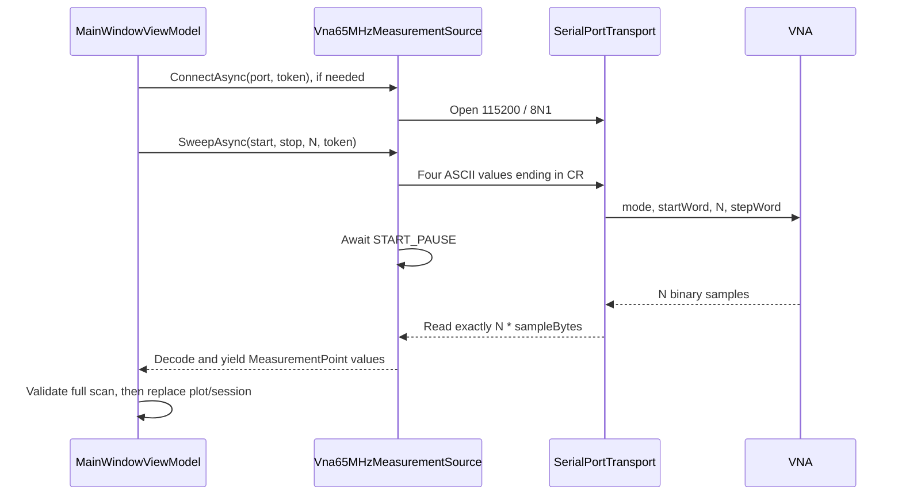

# VNA communication: wire protocol and application behavior

[Polski](VNA-COMMUNICATION.pl.md) · [Evidence and recovery notes](DEVICE-PROTOCOL.md) · [50-ohm measurements](measurements/2026-11-04-com9-50ohm.md)

This document describes the implemented reflection scan protocol and the user's 65 MHz VNA tested on COM9 on 2026-11-04. It distinguishes actual application behavior from unverified firmware features. It is not a universal specification for every miniVNA variant.

## 1. Connection and settings

The application uses `System.IO.Ports.SerialPort` through `SerialPortTransport`. The FTDI driver exposes the USB device as an ordinary serial port. The application does not use the FTDI D2XX API directly.

| Setting | Current value/behavior |
| --- | --- |
| Port name | Supplied by the user: `COM9`, `/dev/ttyUSB0`, `/dev/serial/by-id/...`, etc. |
| Baud rate | 115200 bit/s |
| Data bits / parity / stop bits | 8 / none / 1: 8N1 |
| Flow control | `Handshake.None` |
| DTR / RTS | Not explicitly configured or toggled by this driver |
| Command encoding | ASCII decimal integers, each terminated by CR (`0x0D`) |
| Response encoding | Binary ADC values, not lines or text |
| Default read timeout | 10 seconds for the complete response frame |
| Start pause | 10 ms in the supplied profile, after sending all four command values |

Port enumeration only lists names reported by the OS. Opening a port does not identify the VNA or confirm a measurement response: the connect operation sends no identification request. PuTTY or another analyser can occupy the port; an access error or a failed `mode COM9` query alone cannot distinguish a busy port from other access problems.

The source must be **VNA hardware**. Demonstration and Session playback do not open a serial port. Hardware errors never switch to demonstration data.

User settings are saved in `LocalApplicationData/VnaStudio/settings.json`; on Windows this is normally `%LOCALAPPDATA%\VnaStudio\settings.json`. Relevant fields are:

```json
{
  "PortName": "COM9",
  "MeasurementSource": "hardware"
}
```

The legacy INI is loaded from `analyz.ini` next to the executable, if present, otherwise `Assets/analyser306b-65mhz.ini`. `IOptions<LegacyAnalyzIniOptions>` feeds `LegacyAnalyzIniProfileFactory`, which creates the compatibility `DeviceProfile`; `Vna65MHzProtocolSettings.FromLegacyProfile` then maps that profile into typed plugin settings. The configured port remains in `IOptionsMonitor<AppSettings>` and is passed to the plugin as a `DeviceConnectionRequest` without normalization.

Serial parameters come from `IOptions<Vna65MHzSerialOptions>`. The current application host registers their defaults without binding a JSON serial section. Adding a `BaudRate` key to `settings.json` therefore does not change the speed in the current host.

## 2. One scan, step by step



There is one operation gate in the device driver, so connect, disconnect and scans are serialized. The current scan settings are validated against the profile: Start < Stop, point count 2–4000, and frequencies inside the profile range. Those software limits do not establish hardware support for every point count; physical tests used 16 and 649.

## 3. Commands sent to the device

One reflection scan consists of four decimal ASCII integers, in this exact order:

| Order | Meaning | Terminator |
| --- | --- | --- |
| 1 | Mode: `0` for the implemented reflection scan | CR |
| 2 | Unsigned 32-bit start DDS tuning word | CR |
| 3 | Number of samples `N` | CR |
| 4 | Unsigned 32-bit DDS step word | CR |

No LF, comma, spaces, command names or binary integer encoding are added. Each value is written and flushed; the driver adds no delay between these writes. OS/USB buffering can combine or split writes, so USB packet boundaries are not command boundaries. The application does not wait for an ACK between values and expects the binary measurement response after the sequence.

For a 1–2 MHz scan with 16 samples and DDS_CLOCK=191993220 Hz:

```text
0<CR>22370411<CR>16<CR>1398151<CR>
```

The exact transmitted bytes are:

```text
30 0D 32 32 33 37 30 34 31 31 0D 31 36 0D 31 33 39 38 31 35 31 0D
```

For 1–65 MHz with 649 samples:

```text
0<CR>22370411<CR>649<CR>2206019<CR>
```

Only mode `0` is implemented for the user's VNA 1–65 MHz hardware. Filter mode is available for demo and session playback, but hardware Filter sweeps are rejected before any command is sent. A related MAX4 manual documents mode `1` for its Wobuloscope path, but this has not been verified on this device variant. Generator control and other firmware commands are also not established by these tests.

## 4. DDS words and actual sample frequencies

Let `C` be DDS_CLOCK in Hz, `S` Start in Hz, `E` Stop in Hz, and `N` the number of samples. Let `Q=2^32=4294967296`.

```text
startWord = roundAwayFromZero(S * Q / C)
stepWord  = roundAwayFromZero((E - S) * Q / (C * N))
word(i)   = startWord + i * stepWord                 i = 0 .. N-1
f(i)      = roundAwayFromZero(word(i) * C / Q)       Hz
```

Rounding uses .NET `MidpointRounding.AwayFromZero`. The driver rejects zero/negative step words, values outside UInt32 and a last word exceeding UInt32. `C` is the effective DDS clock, including any multiplier already reflected in DDS_CLOCK; the driver does not multiply it by six again. DDS_PLL is retained as profile metadata but is not separately applied by these serial tuning-word formulas.

The divisor is **N**, not N−1. Therefore Stop is a scan limit, not necessarily the last sampled frequency. The 649-point example has its last reported sample at **64901387 Hz**. The 16-point example ends at **1937500 Hz**. The device does not send frequencies back: the application reconstructs them from the transmitted words. DDS clock accuracy is therefore part of frequency accuracy.

## 5. Binary response and ADC decoding

The supplied profile uses `VNA_type=1` and `SVNA=0`. These are independent settings:

| INI key | Purpose |
| --- | --- |
| VNA_type | Magnitude polarity/reference in the RF calculation |
| SVNA=0 or absent | Four response bytes per point |
| SVNA=1 | Six bytes per point in the recovered receive routine; not tested on physical SVNA hardware |

For the tested device, each point has:

| Byte offset within sample | Contents |
| --- | --- |
| 0 | Phase ADC low byte |
| 1 | Phase ADC high byte, valid range 0–3 |
| 2 | Magnitude ADC low byte |
| 3 | Magnitude ADC high byte, valid range 0–3 |

```text
phaseADC     = byte[0] + (byte[1] << 8)
magnitudeADC = byte[2] + (byte[3] << 8)
```

Each channel is a 10-bit number, 0–1023. A high byte above 3 is rejected. For SVNA=1, bytes 4 and 5 are consumed but not interpreted; six-byte framing does not establish support for that variant's additional acquisition commands.

Expected frame size is exactly `N*4` bytes, or `N*6` for SVNA. Thus 16 samples require 64 bytes and 649 samples require 2596 bytes on the tested device. `ReadExactlyAsync` loops until the complete frame is received; a single stream read may return fewer bytes. A binary `0x0D` or `0x0A` is data, not a delimiter. The implemented protocol has no header, echoed command, frequency field, checksum or sequence number parser: it relies on expected byte count and ADC validation. These checks cannot detect every possible stream misalignment.

At 115200/8N1, 2596 bytes alone occupy about 225 ms of serial line time (10 line bits per byte). This excludes USB latency, firmware processing and pauses; it is not a promised scan duration.

## 6. ADC to RL, phase, SWR and impedance

Magnitude conversion follows the recovered RF path, with the application's signed S11 convention:

```text
M = magnitudeADC * Adc_magres * RL_a + RL_b
signedS11Db = (M - 30 - typeOffsetDb) * polarity - RL_OFFSET_vna

VNA_type=0: typeOffsetDb=0,     polarity=+1
VNA_type=1: typeOffsetDb=-9.84, polarity=-1

phaseDegrees = phaseADC * Adc_phres * PH_a + PH_b
```

The supplied profile has Adc_magres=0.058651026 dB/count, Adc_phres=0.175953079 degrees/count, RL_a=PH_a=1 and RL_b=PH_b=RL_OFFSET_vna=0. Its magnitude formula reduces to `signedS11Db=20.16−magnitudeADC*0.058651026`.

`ReturnLossDb` in the data model stores **signed S11**, `20*log10(|Gamma|)`, which is negative for a passive matched load. Conventional positive return loss equals its negation. The plot labels display the magnitude of loss on the axis. Mixing these conventions previously caused positive signed S11, negative resistance and missing SWR.

Derived quantities use:

```text
rho   = 10^(signedS11Db / 20)
phi   = phaseDegrees * pi / 180
Gamma = rho * (cos(phi) + j*sin(phi))
SWR   = (1 + rho) / (1 - rho)          for rho < 1
Z     = Z0 * (1 + Gamma) / (1 - Gamma)
R     = Re(Z), X = Im(Z), |Z| = sqrt(R^2 + X^2)
```

Z0 is 50 ohm in the supplied profile. SWR is left unavailable for rho>=1. A singular impedance denominator also yields unavailable impedance values. The application does not force an invalid reading to SWR=1.

A real captured sample with the user's 50-ohm termination was `AF 00 C1 03`:

```text
phaseADC=175; magnitudeADC=961
phase=30.791788825 degrees
signedS11=-36.203635986 dB
SWR=1.0314502713
R=51.34131549 ohm; X=0.81399397 ohm; |Z|=51.34776784 ohm
```

The original uses inverse reflection amplitude internally and absolute R/X/SWR. An independent algebra comparison reproduces R, |X|, |Z| and SWR for the default profile. The physical sign of X has not been confirmed. Nonzero PH_b is another limitation: VNA Studio uses the degree-based CSV convention, whereas the original RF path adds it in radians. Original CSV and RF paths also differ in nonzero RL-offset placement; this implementation follows RF magnitude processing.

The UI's additional RL offset is a separate display correction. It recalculates displayed SWR/impedance from a derived copy; it neither changes serial commands nor overwrites session samples. It must not be confused with legacy RL_OFFSET_vna.

## 7. Progress, Hold, Stop and connection lifetime

The driver reads the entire binary frame before yielding the first MeasurementPoint. Therefore point progress can remain at zero during serial reception and then advance quickly during decoding. It is not a live byte-reception counter.

The view model accumulates samples separately. Only a complete, validated sweep replaces the plot and saved-session data. Cancellation or failure retains the previous complete result.

Frequency zoom is retained when another complete sweep uses the same scan settings. Different scan settings reset the view. Plot +/− controls change the displayed frequency span; they do not alter the four transmitted parameters or acquire extra samples.

| Action | Behavior |
| --- | --- |
| Start with Hold checked | One complete scan |
| Clear Hold | Start continuous scans |
| Set Hold during a scan | Finish that scan, then pause |
| Continuous repetition | Wait 100 ms between complete scans; reuse the scan settings captured at Start |
| Stop | Set Hold, cancel the scan token, interrupt serial I/O and close the connection |
| Successful scan after manual Connect | Preserve the manually opened connection |
| Successful scan that opened the connection itself | Close it when the scan/continuous loop ends |
| Failed or cancelled scan | Close the connection; require a fresh open for the next scan |

CancellationToken is passed through connection, command writes, START_PAUSE, stream reads, sample decoding and the interval between scans. Transport cancellation registers disposal of the current SerialPort to unblock I/O when a driver does not react to the stream token. I/O/disposal exceptions caused by cancellation are normalized to OperationCanceledException. Opening runs on a background task; cancellation stops awaiting it, disposes the attempted port and observes any later task failure.

There is **no separately verified device STOP command**. Stop cancels host acquisition and closes the serial connection; it does not prove that the firmware immediately stops its sweep or disables RF output. Successful Stop/reopen was physically tested, but recovery for every interrupted firmware state is not guaranteed.

## 8. Timeout, errors and unsupported settings

The read timeout starts when ReadExactlyAsync begins, after START_PAUSE. It covers the entire requested frame, not each byte, and is not an overall deadline for connection plus writes plus scan. Internally it uses a linked timeout token. An elapsed timeout is reported as TimeoutException; acquisition cleanup then closes the port. The timeout path relies on the underlying read honoring cancellation; the code's forced port-disposal registration is attached to external cancellation. An unresponsive OS driver is therefore not covered by a universal hard timeout guarantee.

An empty stream read before completion is EndOfStreamException. Invalid ADC high bytes are InvalidDataException. An occupied/denied port gets a localized message retaining the original system details. The UI reports these failures and does not commit partial data.

STEP_PAUSE>0 is rejected: no per-point-delay command has been established for this serial sweep. START_PAUSE is a host delay before reading, not a command instructing firmware to delay each point. Hardware transmission/filter sweeps are rejected because their command has not been verified on this VNA 1–65 MHz. Full open/short calibration, cable-loss acquisition and generator RF control remain outside the confirmed protocol described here.

## 9. Evidence and code map

Physical results: 16 points/64 bytes, 649 points/2596 bytes, cancellation during a read and successful restart, plus three 50-ohm scans. The latter gave median SWR about 1.036, overall resistance 50.32–52.72 ohm and varying peaks up to SWR 1.258. They establish basic communication and default-profile math, not absolute calibration accuracy.

Original references include MSComm1's stored 115200 value at executable file offset 0xFC32, separate VNA_type/SVNA initialization, receive procedure VB6_0041cf8d, type-dependent setup at 0042c878–0042c8ba and the RF exponent calculation at 0041ad14–0041ad89. See [evidence notes](DEVICE-PROTOCOL.md) for details. Original binaries, decompilation, and raw local captures are archived outside this project and are not required to build the published project.

| Responsibility | Source |
| --- | --- |
| Port settings, enumeration | [SerialConnectionSettings](../src/Vna.Devices.Transport/SerialConnectionSettings.cs), [SerialPortCatalog](../src/Vna.Devices.Transport/SerialPortCatalog.cs) |
| Open/write/read/cancel | [SerialPortTransport](../src/Vna.Devices.Transport/SerialPortTransport.cs) |
| Serial defaults through IOptions | [Vna65MHzSerialOptions](../src/Vna.Device.Vna65MHz/Vna65MHzSerialOptions.cs) |
| Commands, DDS, framing, decoding | [Vna65MHzMeasurementSource](../src/Vna.Device.Vna65MHz/Vna65MHzMeasurementSource.cs) |
| INI mapping and protocol settings | [LegacyAnalyzIniProfileFactory](../src/Vna.Device.Vna65MHz/LegacyAnalyzIniProfileFactory.cs), [Vna65MHzProtocolSettings](../src/Vna.Device.Vna65MHz/Vna65MHzProtocolSettings.cs) |
| VNA65 ADC/RF conversion | [Vna65MHzRfConverter](../src/Vna.Device.Vna65MHz/Vna65MHzRfConverter.cs); generic impedance math: [RfSampleCalculator](../src/Vna.Core/RfSampleCalculator.cs) |
| Device-independent plugin contract | [DevicePluginContracts](../src/Vna.Core/DevicePluginContracts.cs), [DevicePluginCatalog](../src/Vna.Core/DevicePluginCatalog.cs) |
| Source selection and scan lifecycle | [VnaDeviceRouter](../src/Vna.Devices/VnaDeviceRouter.cs), [MainWindowViewModel](../src/Vna.App/ViewModels/MainWindowViewModel.cs) |
| Regression coverage | [Serial tests](../tests/Vna.Tests/MiniVnaSerialDeviceTests.cs), [ADC tests](../tests/Vna.Tests/LegacyAdcConversionTests.cs) |
