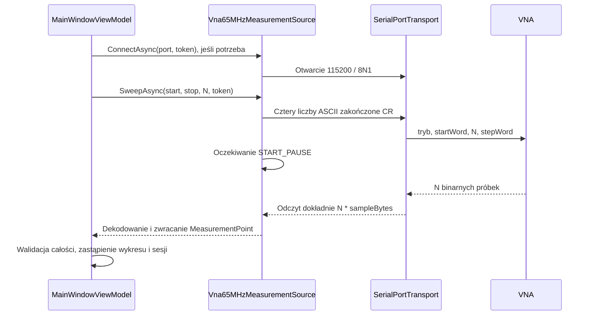

# Komunikacja z VNA: protokół i działanie aplikacji

[English](VNA-COMMUNICATION.md) · [Dowody z analizy oryginału](DEVICE-PROTOCOL.md) · [Pomiary terminatora 50 Ω](measurements/2026-11-04-com9-50ohm.md)

Dokument opisuje zaimplementowany skan odbiciowy oraz egzemplarz VNA użytkownika do 65 MHz, sprawdzony na COM9 w dniu 2026-11-04. Opis działania kodu jest oddzielony od funkcji firmware, których nie potwierdzono. Nie jest to uniwersalna specyfikacja wszystkich odmian miniVNA.

## 1. Połączenie i konfiguracja

Aplikacja używa `System.IO.Ports.SerialPort` przez `SerialPortTransport`. Sterownik FTDI udostępnia urządzenie USB jako zwykły port szeregowy. Aplikacja nie korzysta bezpośrednio z API FTDI D2XX.

| Parametr | Aktualna wartość lub działanie |
| --- | --- |
| Nazwa portu | Podana przez użytkownika: `COM9`, `/dev/ttyUSB0`, `/dev/serial/by-id/...` itp. |
| Prędkość | 115200 bit/s |
| Bity danych / parzystość / bity stopu | 8 / brak / 1, czyli 8N1 |
| Kontrola przepływu | `Handshake.None` |
| DTR / RTS | Sterownik aplikacji nie ustawia ani nie przełącza ich jawnie |
| Kodowanie komend | Dziesiętne liczby całkowite ASCII, każda zakończona CR (`0x0D`) |
| Kodowanie odpowiedzi | Binarne wartości ADC, nie tekst ani wiersze |
| Domyślny timeout odczytu | 10 sekund na całą ramkę odpowiedzi |
| START_PAUSE | W dostarczonym profilu 10 ms, po wysłaniu czterech parametrów skanu |

Wykrywanie portów pobiera tylko nazwy zgłaszane przez system. Otwarcie portu nie identyfikuje analizatora ani nie potwierdza odpowiedzi pomiarowej: operacja połączenia nie wysyła zapytania o identyfikator. PuTTY lub inny analizator może zajmować port. Sam błąd dostępu albo wynik `mode COM9` nie rozstrzyga, czy przyczyną jest zajęcie portu, sterownik czy inne ograniczenie dostępu.

Źródłem pomiaru musi być **Urządzenie VNA**. Demonstrator i odtwarzanie sesji nie otwierają portu. Błąd sprzętu nie przełącza aplikacji na dane demonstracyjne.

Ustawienia użytkownika są zapisywane w `LocalApplicationData/VnaStudio/settings.json`; w Windows zwykle jest to `%LOCALAPPDATA%\VnaStudio\settings.json`. Pola dotyczące połączenia:

```json
{
  "PortName": "COM9",
  "MeasurementSource": "hardware"
}
```

Plik legacy INI jest odczytywany z `analyz.ini` obok pliku wykonywalnego, jeśli istnieje; w przeciwnym razie z `Assets/analyser306b-65mhz.ini`. `IOptions<LegacyAnalyzIniOptions>` zasila `LegacyAnalyzIniProfileFactory`, która tworzy zgodnościowy `DeviceProfile`; następnie `Vna65MHzProtocolSettings.FromLegacyProfile` mapuje ten profil na typowane ustawienia pluginu. Skonfigurowany port pozostaje w `IOptionsMonitor<AppSettings>` i trafia do pluginu w `DeviceConnectionRequest` bez normalizacji.

Parametry transmisji pochodzą z `IOptions<Vna65MHzSerialOptions>`. Obecny host aplikacji rejestruje wartości domyślne bez wiązania sekcji serial z JSON. Dopisanie `BaudRate` do `settings.json` nie zmienia więc aktualnie prędkości transmisji.

## 2. Przebieg jednego skanu



Sterownik urządzenia ma jedną blokadę operacji: łączenie, rozłączanie i skanowanie są wykonywane kolejno. Ustawienia są sprawdzane przed skanem: Start < Stop, 2–4000 punktów i częstotliwości wewnątrz zakresu profilu. Te granice programowe nie potwierdzają obsługi każdej liczby punktów przez firmware; na sprzęcie sprawdzano 16 i 649.

## 3. Dokładna postać wysyłanych komend

Skan odbiciowy składa się z czterech dziesiętnych liczb ASCII wysyłanych w tej kolejności:

| Kolejność | Znaczenie | Zakończenie |
| --- | --- | --- |
| 1 | Tryb: `0` dla zaimplementowanego skanu odbiciowego | CR |
| 2 | Początkowe słowo strojenia DDS, UInt32 | CR |
| 3 | Liczba próbek `N` | CR |
| 4 | Krok słowa strojenia DDS, UInt32 | CR |

Nie są dodawane LF, przecinki, spacje, nazwy komend ani binarne reprezentacje liczb. Po zapisie każdej wartości wykonywane jest opróżnienie strumienia `FlushAsync`. Sterownik nie wstawia pauzy między zapisami. System i USB mogą łączyć albo dzielić zapisy, dlatego granice pakietów USB nie wyznaczają granic komend. Aplikacja nie czeka na ACK między parametrami; po całej sekwencji oczekuje binarnej odpowiedzi pomiarowej.

Dla zakresu 1–2 MHz, 16 próbek i DDS_CLOCK=191993220 Hz sekwencja ma postać:

```text
0<CR>22370411<CR>16<CR>1398151<CR>
```

Dokładne bajty wysłane do portu:

```text
30 0D 32 32 33 37 30 34 31 31 0D 31 36 0D 31 33 39 38 31 35 31 0D
```

Dla zakresu 1–65 MHz i 649 próbek:

```text
0<CR>22370411<CR>649<CR>2206019<CR>
```

Na sprzętowym VNA 1–65 MHz sterownik używa wyłącznie trybu `0`. Tryb Filter jest dostępny dla danych demo i odtwarzania sesji, ale skan sprzętowy Filter jest odrzucany przed wysłaniem jakiejkolwiek komendy. W pokrewnej instrukcji MAX4 opisano tryb `1` dla ścieżki Wobuloscope, lecz nie potwierdzono go na tym wariancie urządzenia. Testy nie ustalają też komend generatora ani pozostałych funkcji firmware.

## 4. Słowa DDS i rzeczywiste częstotliwości próbek

Niech `C` oznacza DDS_CLOCK w Hz, `S` początek w Hz, `E` koniec w Hz, a `N` liczbę próbek. `Q=2^32=4294967296`.

```text
startWord = roundAwayFromZero(S * Q / C)
stepWord  = roundAwayFromZero((E - S) * Q / (C * N))
word(i)   = startWord + i * stepWord                 i = 0 .. N-1
f(i)      = roundAwayFromZero(word(i) * C / Q)       Hz
```

Zaokrąglanie odpowiada `.NET MidpointRounding.AwayFromZero`. Odrzucany jest zerowy lub ujemny krok, słowo poza UInt32 i ostatnie słowo przekraczające UInt32. `C` to efektywny zegar DDS, z mnożnikiem już uwzględnionym w DDS_CLOCK; sterownik nie mnoży tej wartości ponownie przez sześć. DDS_PLL jest zachowane w profilu, ale nie jest osobno stosowane w tych wzorach transmisji szeregowej.

W mianowniku jest **N**, a nie N−1. Stop stanowi więc granicę zakresu, niekoniecznie częstotliwość ostatniej próbki. Dla podanego skanu 649-punktowego ostatnia raportowana częstotliwość to **64901387 Hz**. Skan 16-punktowy kończy się na **1937500 Hz**. Urządzenie nie odsyła częstotliwości: program wylicza ją z wysłanych słów. Dokładność zegara DDS wpływa więc na dokładność częstotliwości.

## 5. Odpowiedź binarna i dekodowanie ADC

Profil użytkownika ma `VNA_type=1` i `SVNA=0`. Są to niezależne ustawienia:

| Ustawienie INI | Znaczenie |
| --- | --- |
| VNA_type | Wybór polaryzacji i poziomu odniesienia magnitudy w obliczeniach RF |
| SVNA=0 albo brak klucza | Cztery bajty odpowiedzi na punkt |
| SVNA=1 | Sześć bajtów w odzyskanej procedurze odbioru; brak testu fizycznego sprzętu SVNA |

Dla sprawdzonego urządzenia próbka ma układ:

| Offset w próbce | Zawartość |
| --- | --- |
| 0 | Młodszy bajt ADC fazy |
| 1 | Starszy bajt ADC fazy, dopuszczalne 0–3 |
| 2 | Młodszy bajt ADC magnitudy |
| 3 | Starszy bajt ADC magnitudy, dopuszczalne 0–3 |

```text
phaseADC     = byte[0] + (byte[1] << 8)
magnitudeADC = byte[2] + (byte[3] << 8)
```

Każdy kanał jest liczbą 10-bitową z zakresu 0–1023. Starszy bajt powyżej 3 powoduje błąd. Przy SVNA=1 bajty 4 i 5 są odbierane, ale nieinterpretowane; obsługa długości ramki nie dowodzi zgodności komend dodatkowego wariantu SVNA.

Program oczekuje dokładnie `N*4` bajtów lub `N*6` przy SVNA. Na sprawdzonym urządzeniu 16 próbek daje 64 bajty, a 649 próbek — 2596 bajtów. `ReadExactlyAsync` wykonuje kolejne odczyty aż do zebrania całości; jeden odczyt strumienia może zwrócić mniej danych. Binarne `0x0D` i `0x0A` są danymi, nie separatorami. Implementacja nie parsuje nagłówka, echa komend, pola częstotliwości, sumy kontrolnej ani numeru sekwencji: opiera się na oczekiwanej liczbie bajtów i walidacji ADC. Nie wykryje tym każdej możliwej utraty synchronizacji.

Przy 115200/8N1 samo przesłanie 2596 bajtów zajmuje około 225 ms czasu linii (10 bitów transmisji na bajt). Nie obejmuje to opóźnień USB, przetwarzania firmware i pauz, więc nie jest gwarantowanym czasem skanu.

## 6. Przeliczenie ADC na RL, fazę, SWR i impedancję

Magnituda jest przeliczana zgodnie z odzyskaną ścieżką RF i konwencją podpisanego S11 w aplikacji:

```text
M = magnitudeADC * Adc_magres * RL_a + RL_b
signedS11Db = (M - 30 - typeOffsetDb) * polarity - RL_OFFSET_vna

VNA_type=0: typeOffsetDb=0,     polarity=+1
VNA_type=1: typeOffsetDb=-9.84, polarity=-1

phaseDegrees = phaseADC * Adc_phres * PH_a + PH_b
```

Profil użytkownika ma Adc_magres=0.058651026 dB/krok ADC, Adc_phres=0.175953079 stopnia/krok ADC, RL_a=PH_a=1 oraz RL_b=PH_b=RL_OFFSET_vna=0. Wtedy magnituda upraszcza się do `signedS11Db=20.16−magnitudeADC*0.058651026`.

Pole modelu `ReturnLossDb` zawiera **podpisane S11**, czyli `20*log10(|Gamma|)`. Dla pasywnego, dopasowanego obciążenia jest ujemne. Klasyczny dodatni return loss jest jego przeciwną wartością. Podziałka wykresu pokazuje wielkość straty. Pomieszanie tych konwencji powodowało wcześniej dodatnie S11, ujemną rezystancję i brak SWR.

Wartości pochodne są obliczane tak:

```text
rho   = 10^(signedS11Db / 20)
phi   = phaseDegrees * pi / 180
Gamma = rho * (cos(phi) + j*sin(phi))
SWR   = (1 + rho) / (1 - rho)          dla rho < 1
Z     = Z0 * (1 + Gamma) / (1 - Gamma)
R     = Re(Z), X = Im(Z), |Z| = sqrt(R^2 + X^2)
```

Z0 w dostarczonym profilu wynosi 50 Ω. Dla rho>=1 SWR pozostaje niedostępny. Osobliwość mianownika impedancji również daje niedostępne wartości. Program nie wymusza SWR=1 dla niewłaściwego odczytu.

Rzeczywista próbka z terminatorem 50 Ω użytkownika miała bajty `AF 00 C1 03`:

```text
phaseADC=175; magnitudeADC=961
faza=30.791788825 stopnia
signedS11=-36.203635986 dB
SWR=1.0314502713
R=51.34131549 Ω; X=0.81399397 Ω; |Z|=51.34776784 Ω
```

Oryginał wewnętrznie używa odwrotności amplitudy współczynnika odbicia i wartości bezwzględnych R/X/SWR. Niezależne porównanie algebry daje zgodne R, |X|, |Z| i SWR dla profilu domyślnego. Fizyczny znak X nie jest potwierdzony. Dodatkowym ograniczeniem jest niezerowe PH_b: VNA Studio stosuje konwencję stopni z CSV, podczas gdy ścieżka RF oryginału dodaje tę poprawkę w radianach. Oryginalne ścieżki CSV i RF różnią się też miejscem stosowania niezerowego offsetu RL; implementacja odpowiada ścieżce RF dla magnitudy.

Dodatkowe przesunięcie RL w interfejsie jest osobną korektą prezentacji. Przelicza widoczne SWR/impedancję na kopii wyników; nie zmienia komend ani próbek zapisanych w sesji. Nie jest to to samo co legacy RL_OFFSET_vna.

## 7. Postęp, Hold, Stop i czas życia połączenia

Sterownik odbiera całą ramkę przed zwróceniem pierwszego MeasurementPoint. Dlatego postęp punktowy może pozostawać na zerze podczas odbioru, a następnie szybko wzrosnąć podczas dekodowania. Nie jest licznikiem odebranych bajtów.

ViewModel zbiera próbki osobno. Dopiero kompletny, zweryfikowany skan zastępuje wykres i dane sesji. Anulowanie albo błąd pozostawia poprzedni pełny wynik.

Zoom częstotliwości jest zachowywany, gdy kolejny pełny skan używa tych samych ustawień. Inne ustawienia skanu resetują widok. Przyciski +/− zmieniają wyświetlany zakres częstotliwości; nie zmieniają czterech wysyłanych parametrów i nie pobierają dodatkowych próbek.

| Operacja | Działanie |
| --- | --- |
| Start przy zaznaczonym Hold | Jeden kompletny skan |
| Odznaczenie Hold | Uruchomienie skanów ciągłych |
| Zaznaczenie Hold podczas skanu | Dokończenie bieżącego skanu i pauza |
| Powtarzanie ciągłe | 100 ms między pełnymi skanami; ustawienia zakresu/liczby punktów są pobierane przy Start |
| Stop | Zaznaczenie Hold, anulowanie tokenu skanu, przerwanie operacji portu i zamknięcie połączenia |
| Pełny skan po ręcznym Połącz | Zachowanie ręcznie otwartego połączenia |
| Pełny skan, który sam otworzył połączenie | Zamknięcie po zakończeniu skanu lub pętli ciągłej |
| Błąd lub anulowanie | Zamknięcie połączenia; następny skan wymaga ponownego otwarcia |

CancellationToken jest przekazywany przez łączenie, zapis komend, START_PAUSE, odczyt strumienia, dekodowanie próbek i pauzę między skanami. Transport rejestruje przy anulowaniu zwolnienie bieżącego SerialPort, aby przerwać I/O również wtedy, gdy sterownik nie reaguje na token strumienia. Wyjątki I/O/zamknięcia wywołane anulowaniem są zamieniane na OperationCanceledException. Otwarcie portu odbywa się w zadaniu w tle; anulowanie przerywa oczekiwanie, zwalnia otwierany port i obserwuje ewentualny późniejszy błąd zadania.

Nie ma **osobnej, zweryfikowanej komendy STOP do urządzenia**. Stop anuluje odbiór po stronie komputera i zamyka port; nie dowodzi to natychmiastowego zakończenia skanu firmware ani wyłączenia RF. Sprawdzono fizycznie Stop i ponowne otwarcie, ale nie wszystkie możliwe stany firmware po przerwaniu.

## 8. Timeout, błędy i nieobsługiwane ustawienia

Timeout odczytu rozpoczyna się przy wejściu do ReadExactlyAsync, po START_PAUSE. Dotyczy całej ramki, nie pojedynczego bajtu; nie obejmuje łącznie otwierania portu, zapisów i całego skanu. Używany jest połączony token z timeoutem. Przekroczenie czasu zgłaszane jest jako TimeoutException, po czym sprzątanie skanu zamyka port. Ta ścieżka polega na obsłużeniu anulowania przez odczyt strumienia; wymuszone zwolnienie portu jest zarejestrowane dla anulowania zewnętrznego. Nie ma więc uniwersalnej gwarancji twardego limitu czasu przy zawieszonym sterowniku systemowym.

Odczyt pustego strumienia przed zebraniem ramki daje EndOfStreamException. Nieprawidłowy starszy bajt ADC daje InvalidDataException. Błąd dostępu do portu ma zlokalizowany opis zachowujący szczegóły systemowe. Aplikacja pokazuje błąd i nie zapisuje niepełnego skanu jako nowego wyniku.

STEP_PAUSE>0 jest odrzucane: nie ustalono komendy pauzy między punktami tego protokołu. START_PAUSE to pauza komputera przed odczytem, a nie polecenie opóźnienia każdego pomiaru firmware. Skan transmisji/filtra na sprzęcie jest odrzucany, bo jego komenda nie została potwierdzona dla VNA 1–65 MHz. Pełna kalibracja open/short, akwizycja strat kabla i sterowanie RF generatora pozostają poza potwierdzonym zakresem protokołu.

## 9. Dowody i mapa kodu

Na sprzęcie potwierdzono 16 punktów/64 bajty, 649 punktów/2596 bajtów, anulowanie odczytu i poprawny restart oraz trzy skany terminatora 50 Ω. Mediana SWR wyniosła około 1,036, łączny zakres R 50,32–52,72 Ω, a zmienne piki dochodziły do SWR 1,258. Potwierdza to podstawową komunikację i matematykę profilu domyślnego, nie dokładność pełnej kalibracji.

Dowody z oryginału obejmują zapisane 115200 w MSComm1 przy offsecie pliku EXE 0xFC32, osobną inicjalizację VNA_type/SVNA, odbiór VB6_0041cf8d, wybór wariantu przy 0042c878–0042c8ba i obliczanie wykładnika RF przy 0041ad14–0041ad89. Szczegóły: [analiza protokołu](DEVICE-PROTOCOL.md). Oryginalne programy, dekompilacja i surowe lokalne przechwycenia są poza tym projektem i nie są wymagane do jego zbudowania.

| Odpowiedzialność | Plik |
| --- | --- |
| Ustawienia i wykrywanie portów | [SerialConnectionSettings](../src/Vna.Devices.Transport/SerialConnectionSettings.cs), [SerialPortCatalog](../src/Vna.Devices.Transport/SerialPortCatalog.cs) |
| Otwieranie, zapis, odczyt i anulowanie | [SerialPortTransport](../src/Vna.Devices.Transport/SerialPortTransport.cs) |
| Domyślne parametry szeregowe przez IOptions | [Vna65MHzSerialOptions](../src/Vna.Device.Vna65MHz/Vna65MHzSerialOptions.cs) |
| Komendy, DDS, ramki i dekodowanie | [Vna65MHzMeasurementSource](../src/Vna.Device.Vna65MHz/Vna65MHzMeasurementSource.cs) |
| Wiązanie INI i ustawienia protokołu | [LegacyAnalyzIniProfileFactory](../src/Vna.Device.Vna65MHz/LegacyAnalyzIniProfileFactory.cs), [Vna65MHzProtocolSettings](../src/Vna.Device.Vna65MHz/Vna65MHzProtocolSettings.cs) |
| Przeliczenie ADC/RF VNA65 | [Vna65MHzRfConverter](../src/Vna.Device.Vna65MHz/Vna65MHzRfConverter.cs); wspólna matematyka impedancji: [RfSampleCalculator](../src/Vna.Core/RfSampleCalculator.cs) |
| Neutralny kontrakt pluginu | [DevicePluginContracts](../src/Vna.Core/DevicePluginContracts.cs), [DevicePluginCatalog](../src/Vna.Core/DevicePluginCatalog.cs) |
| Wybór źródła i przebieg skanu | [VnaDeviceRouter](../src/Vna.Devices/VnaDeviceRouter.cs), [MainWindowViewModel](../src/Vna.App/ViewModels/MainWindowViewModel.cs) |
| Testy regresji | [Testy transmisji](../tests/Vna.Tests/MiniVnaSerialDeviceTests.cs), [Testy ADC](../tests/Vna.Tests/LegacyAdcConversionTests.cs) |
